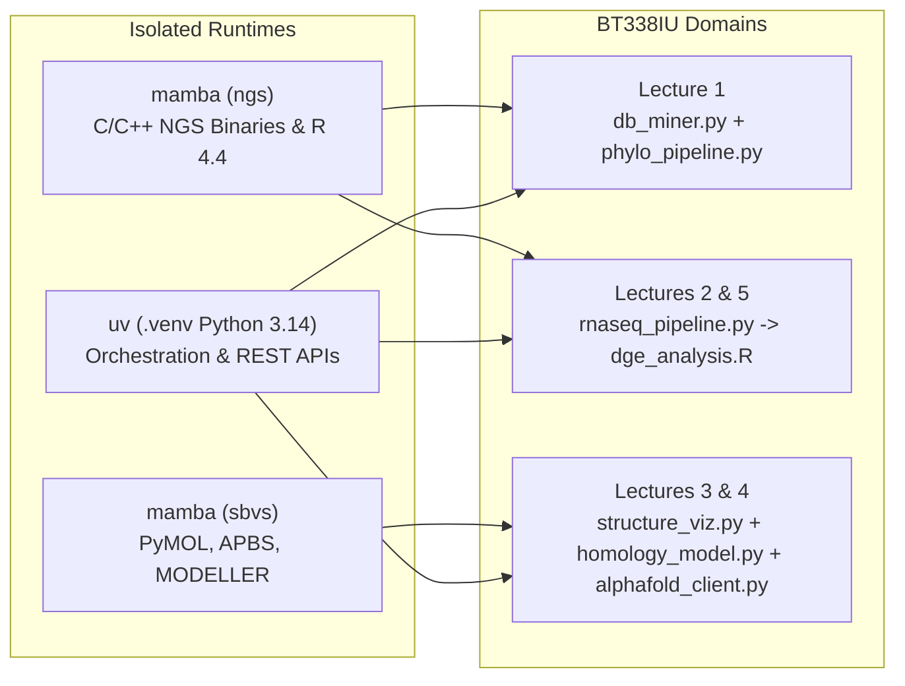
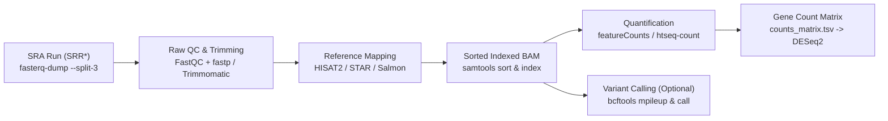

# BT338IU Practice in Bioinformatics — Pipeline Self-Study Guide

> **Purpose:** This guide deconstructs every tool in `src/` so you never run the automation as a black box. For each module, you will study the **biological problem**, **underlying algorithm and math**, **code mechanics inside `src/`**, **manual single-step commands** to practice by hand, and **exam-relevant interpretation checks**.

---

## TABLE OF CONTENTS

- [1. Executive Overview & Mental Model](#1-executive-overview--mental-model)
- [2. Environment Engineering: `uv` + `mamba` + `renv`](#2-environment-engineering-uv--mamba--renv)
- [3. Module A (Lecture 1): Database APIs & Assay Profiling (`db_miner.py`)](#3-module-a-lecture-1-database-apis--assay-profiling-db_minerpy)
- [4. Module B (Lecture 1): BLAST, MSA & Phylogenetics (`phylo_pipeline.py`)](#4-module-b-lecture-1-blast-msa--phylogenetics-phylo_pipelinepy)
- [5. Module C (Lectures 1–2): Local RNA-Seq Pipeline (`rnaseq_pipeline.py`)](#5-module-c-lectures-12-local-rna-seq-pipeline-rnaseq_pipelinepy)
- [6. Module D (Lectures 2 & 5): Differential Expression & Enrichment (`dge_analysis.R`)](#6-module-d-lectures-2--5-differential-expression--enrichment-dge_analysisr)
- [7. Module E (Lecture 3): 3D Visualization & Offline Electrostatics (`structure_viz.py`)](#7-module-e-lecture-3-3d-visualization--offline-electrostatics-structure_vizpy)
- [8. Module F (Lecture 4A): Homology Modeling (`homology_model.py`)](#8-module-f-lecture-4a-homology-modeling-homology_modelpy)
- [9. Module G (Lecture 4B): AI Structure Prediction (`alphafold_client.py`)](#9-module-g-lecture-4b-ai-structure-prediction-alphafold_clientpy)
- [10. Exam & Viva Mastery Checklist](#10-exam--viva-mastery-checklist)

---

## 1. Executive Overview & Mental Model

Dr. Tran Minh Nhựt's `BT338IU` curriculum teaches two complementary computational workflows:

1. **Transcriptomics (`FASTQ` $\rightarrow$ Biological Pathways):** Quality control, genome mapping, gene-level read counting, generalized linear modeling (`DESeq2` / `edgeR`), and functional interpretation.
2. **Structural Bioinformatics (`Sequence` $\rightarrow$ `3D Coordinates` $\rightarrow$ Function):** Molecular graphics (`PyMOL`), continuum electrostatics (`PDB2PQR` + `APBS`), template-based spatial restraint modeling (`MODELLER`), and deep-learning folding (`AlphaFold`).



[!TIP]
**How to study with this repo:** Never jump straight to `--preset all` or `--case all`. First run the **manual single-tool commands** shown in each chapter on one gene, one protein, or one SRR accession, inspect every intermediate file (`FASTQ`, `SAM`, `BAM`, `.pir`, `.pqr`, `.dx`), and only then use the automation to scale across all exercises.

---

## 2. Environment Engineering: `uv` + `mamba` + `renv`

Bioinformatics tools span pure Python, compiled C/C++/Java binaries, and Bioconductor R libraries with incompatible ABI pins. Understanding *why* this repository layers three package managers prepares you for production pipeline engineering (Nextflow/Docker/HPC).

| Layer | What Lives Here | Why Not Put Everything in One Tool? |
| :--- | :--- | :--- |
| **`uv` (`pyproject.toml`, `uv.lock`)** | Pure-Python REST clients, `biopython`, `openpyxl`, `matplotlib`, `pytest`, `ruff` | Fast deterministic resolution on system Python 3.14 without polluting conda environments |
| **`mamba` `ngs`** | `sra-tools`, `fastp`, `fastqc`, `hisat2`, `star`, `salmon`, `subread`, `samtools`, `bcftools`, `mafft`, `fasttree`, `blast`, R 4.4 + Bioconductor 3.20 | Provides pre-compiled C/C++ aligners and Bioconductor binaries; avoids 30-minute source builds |
| **`mamba` `sbvs`** | `pymol-open-source 3.1`, `pdb2pqr 3.8`, `apbs 3.4`, `modeller 10.8`, `rdkit`, `vina` | Isolates structural C++/Qt dependencies (`Python 3.11`) away from `ngs` (`Python 3.14`) |
| **`uvx --python 3.13`** | `HTSeq` (`htseq-count`) | `HTSeq 2.1.2` requires `Python <= 3.13`, whereas `ngs` pins `Python 3.14`; `uvx` runs it ephemerally |
| **`renv` (`renv.lock`, `.Rprofile`)** | Snapshot of 140+ R/Bioconductor packages hydrated from `ngs` | Guarantees exact version reproducibility (`DESeq2 1.46.0`, `clusterProfiler 4.14.0`) |

### Subtle CLI Detail: Keeping `--help` Clean in R

When `renv` creates `.Rprofile`, any `Rscript` invocation inside the repo folder executes `source("renv/activate.R")` before running line 1 of your script. Left unchecked, `renv` prints startup banners to `stdout`, breaking POSIX CLI contracts (`<tool> --help` and error-only `stderr`).

In `src/dge_analysis.R`, two mechanisms prevent that:

1. The shebang `#!/usr/bin/env -S Rscript --no-init-file` skips `.Rprofile` so `--help`, invalid-flag errors, and `--dry-run` execute instantaneously with clean streams.
2. After CLI flags are parsed, `dge_analysis.R` explicitly prepends `/home/ht2905/miniforge3/envs/ngs/lib/R/library` to `.libPaths()` before loading `DESeq2`/`edgeR`.

### Hands-On Check

```bash
# Compare which R binary and library paths load in each context
which Rscript
mamba run -n ngs Rscript -e 'cat(R.version.string, "\n"); print(.libPaths())'
/usr/bin/env -S Rscript --no-init-file -e 'print(.libPaths())'
```

---

## 3. Module A (Lecture 1): Database APIs & Assay Profiling (`db_miner.py`)

### Concepts You Need to Know

1. **Primary vs. Secondary vs. Specialized Databases:**
   - **Primary (Archival):** Raw submitter records with minimal curation (`GenBank`, `EMBL`, `DDBJ`, `RCSB PDB`). Major pitfalls: **sequence redundancy** and **erroneous submitter annotations**.
   - **RefSeq (`NR_`, `NM_`, `NP_`, `NC_`, `GCF_`):** NCBI's non-redundant, curated reference layer that resolves GenBank clutter (e.g., filtering out cloning vectors like `KJ904690.1` when searching `Human SIRT1`).
   - **Secondary (Curated):** `UniProtKB/Swiss-Prot` (manually reviewed, rich feature annotations) vs. `TrEMBL` (automated computational translations).
2. **PubChem BioAssay Profiling & PAINS Detection:**
   - In drug discovery, a compound that lights up across many unrelated enzyme targets is often a **PAINS** (Pan-Assay Interference Compound) acting via aggregation, redox cycling, metal chelation, or optical interference.
   - `db_miner.py` computes the active fraction $\frac{N_{\text{active}}}{N_{\text{total}}}$ from PubChem's `assaysummary/CSV` endpoint and flags compounds exceeding `10%` (`PAINS_ACTIVE_PCT_THRESHOLD = 10.0`). Compare **Curcumin (`CID 969516`, ~18.5% active)** against selective approved drugs like **Acetaminophen (`CID 1983`, ~1.0% active)**.

### How `src/db_miner.py` Works Under the Hood

| Function | Endpoint / Tool Called | Key Filtering Logic |
| :--- | :--- | :--- |
| `query_ncbi()` | Shells out to your `$PATH` script `ncbi-fetch` (`esearch.fcgi` + `esummary.fcgi` + `efetch.fcgi`) | Sorts by `relevance`, formats summary TSV, downloads top FASTA |
| `query_uniprot()` | `GET https://rest.uniprot.org/uniprotkb/search?format=json` | Automatically converts `"human"` to `(organism_id:9606)` and selects the first `Swiss-Prot` (Reviewed) entry over `TrEMBL` |
| `query_pubchem()` | `PUG-REST`: `/name/.../cids/JSON`, `/property/.../JSON`, `/synonyms/JSON`, `/assaysummary/CSV` | Resolves Best Match CID, extracts CAS via `^\d{2,7}-\d{2}-\d$`, computes BioAssay outcome counts |
| `query_rcsb_pdb()` | `POST search.rcsb.org/rcsbsearch/v2/query` + `POST data.rcsb.org/graphql` | Uses Search v2 for total structure count and GraphQL to batch-fetch method and resolution in 1 HTTP call |

### Do It Yourself (Manual Equivalent)

```bash
# 1. Inspect raw NCBI Entrez JSON directly using curl + jq (what ncbi-fetch wraps)
curl -sG "https://eutils.ncbi.nlm.nih.gov/entrez/eutils/esearch.fcgi" \
    --data-urlencode "db=nuccore" \
    --data-urlencode "term=SIRT1 AND Homo sapiens[Organism] AND refseq[filter]" \
    --data-urlencode "retmode=json" | jq '.esearchresult | {count, idlist}'

# 2. Fetch raw UniProt JSON for GLP1R (P43220) and inspect reviewed status + length
curl -s "https://rest.uniprot.org/uniprotkb/P43220.json" \
    | jq '{accession: .primaryAccession, type: .entryType, length: .sequence.length}'

# 3. Compare our automated summary against your manual curl inspection
uv run python3 src/db_miner.py -s pubchem -q acetaminophen --stdout
```

---

## 4. Module B (Lecture 1): BLAST, MSA & Phylogenetics (`phylo_pipeline.py`)

### Concepts You Need to Know

1. **Why BLAST Is Heuristic (Not Optimal):**
   - Exact global (**Needleman–Wunsch**) and local (**Smith–Waterman**) dynamic programming scale as $O(m \cdot n)$ per pairwise comparison—prohibitively slow against millions of `nr`/`nt` sequences.
   - **BLAST** accelerates search by breaking the query into short $k$-mers (words, typically $k=3$ for protein, $k=11$ for nucleotide), finding exact/high-scoring seed hits in a database index, and extending locally into High-scoring Segment Pairs (HSPs).
   - **5 BLAST Modes:** `blastn` (DNA $\rightarrow$ DNA), `blastp` (Protein $\rightarrow$ Protein), `blastx` (translated DNA $\rightarrow$ Protein), `tblastn` (Protein $\rightarrow$ translated DNA), `tblastx` (translated DNA $\rightarrow$ translated DNA).
2. **Multiple Sequence Alignment (MSA) & Tree Inference:**
   - **ClustalW** (manual) uses classic progressive alignment (pairwise distances $\rightarrow$ guide tree $\rightarrow$ progressive profile alignment), which can lock in early alignment mistakes.
   - **MAFFT** (`--auto`) builds progressive FFT-accelerated alignments and refines them iteratively, scaling well to hundreds of sequences.
   - **FastTree** infers an approximately-maximum-likelihood phylogenetic tree in $O(N^{1.25} \log N)$ time using the **WAG** amino-acid substitution model (`blastp`) or **GTR** nucleotide model (`-nt -gtr` for `blastn`), producing a standard Newick (`.nwk`) tree you can plot in `ggtree` or open in **MEGA 12**.

### How `src/phylo_pipeline.py` Works Under the Hood

1. `fetch_query_fasta()`: Downloads the seed sequence via `ncbi-fetch` (with `efetch.fcgi` fallback).
2. `run_remote_blast()`: Submits a `CMD=Put` job to NCBI QBLAST, parses the Request ID (`RID`), polls `SearchInfo` every `10s` until `Status=READY`, and extracts unique hit accessions from the returned XML.
3. `batch_fetch_sequences()`: Downloads all top-100 hit FASTAs in batches of 100 (`0.35s` polite rate-limit sleep).
4. `mafft --auto` $\rightarrow$ `FastTree` $\rightarrow$ `render_tree_plot()` (calls R `ggtree` or `ape::plot.phylo`).

### Do It Yourself (Manual Equivalent)

```bash
# Run a small offline alignment + tree on 5-10 sequences in .scratch/ to see each step
mkdir -p .scratch/phylo-diy
ncbi-fetch -i "NP_000509,XP_508242,NP_001257813,NP_058652,NP_990820" -o .scratch/phylo-diy/hbb.fasta
mamba run -n ngs mafft --auto .scratch/phylo-diy/hbb.fasta > .scratch/phylo-diy/hbb_aligned.fasta
mamba run -n ngs FastTree .scratch/phylo-diy/hbb_aligned.fasta > .scratch/phylo-diy/hbb.nwk
cat .scratch/phylo-diy/hbb.nwk
```

[!NOTE]
**Question to test yourself:** Why does `slides_week-01.pdf` (p. 20) recommend nucleotide sequences for *closely related* organisms and amino acid sequences for *distantly related* organisms? Think about synonymous codon degeneracy (silent third-base wobble) vs. 20-letter protein alphabet saturation over deep evolutionary divergence.

---

## 5. Module C (Lectures 1–2): Local RNA-Seq Pipeline (`rnaseq_pipeline.py`)

### Concepts You Need to Know



1. **FASTQ & Phred Quality Scores (`Phred-33`):**
   - Every read has 4 lines: `@ID`, nucleotide sequence, `+`, and ASCII quality string (`ASCII - 33 = Q`).
   - Logarithmic error probability:
     $$Q = -10 \log_{10}(P_{\text{error}})$$
     So $Q = 20 \implies 1\text{ in }100$ error ($99\%$ accuracy), and $Q = 30 \implies 1\text{ in }1000$ error ($99.9\%$ accuracy).
2. **Why Modern (`fastp` + `HISAT2`/`STAR`/`Salmon` + `featureCounts`) Beats Galaxy (`Trimmomatic` + `HTSeq`):**
   - **`fastp` vs. `Trimmomatic`:** `fastp` is written in multithreaded C++ and automatically detects adapters, trims sliding windows, filters low-Q reads, and writes both HTML/JSON QC plots in a single pass—often 10–20$\times$ faster than Java `Trimmomatic`.
   - **`HISAT2` vs. `STAR` vs. `Salmon`:**
     - `HISAT2` uses a hierarchical graph FM-index (low RAM, ~4–8 GB for mammalian genomes, splice-aware—ideal for your 16 GB laptop on mouse/human datasets).
     - `STAR` uses uncompressed suffix arrays (blazingly fast, but human/mouse indices need >30 GB RAM; works nicely on smaller bacterial/yeast/plant genomes with auto-scaled `--genomeSAindexNbases`).
     - `Salmon` performs lightweight **quasi-mapping** directly against transcriptomes (`rna.fna`) in seconds, though it skips genome-coordinate BAM generation (so no `IGV` track or `bcftools` VCF).
   - **`featureCounts` vs. `htseq-count`:** `featureCounts` (C, multi-threaded `-T 8`) counts millions of paired alignments in seconds; `htseq-count` (single-threaded Python) takes several minutes per sample for identical GTF exon-overlap logic.
3. **SAM vs. BAM & Coordinate Sorting:**
   - `SAM` is uncompressed plain text (11 mandatory tab-delimited columns including `FLAG`, `RNAME`, `POS`, `MAPQ`, `CIGAR`).
   - `BAM` is BGZF-compressed binary. Coordinate sorting (`samtools sort`) + indexing (`.bai`) is mandatory before random-access tools (`IGV`, `bcftools mpileup`) can read regions without scanning from byte 0.

### How `src/rnaseq_pipeline.py` Works Under the Hood

- **`parse_groups_xlsx()`:** Parses `references/group-datasets.xlsx` (`dataBI` and `DATASET` sheets), handling merged/split label rows (`Demo`) and deduplicating long condition prefixes (`_slugify_condition()`).
- **`fetch_genome_bundle()`:** Calls NCBI Datasets v2 REST API to fetch `GENOME_FASTA`, `GENOME_GTF`, `GENOME_GFF`, and `RNA_FASTA` for any `GCF_*` accession in one zip archive.
- **`write_compat_summary()` (`--emit-compat-logs`):** Reads `fastp.json` (`before_filtering.total_reads`, `after_filtering.total_reads`, `q30_rate`) and `hisat2.log`, printing exact Trimmomatic-style `Input Reads / Surviving / Dropped` lines so your report matches Dr. Nhut's slides while keeping `fastp`'s speed.

### Do It Yourself (Manual Equivalent on 1 Bacterial Sample)

```bash
# Try running the core pipeline by hand on 1 E. coli SRR sample inside .scratch/
mkdir -p .scratch/rnaseq-diy && cd .scratch/rnaseq-diy
mamba run -n ngs fasterq-dump --split-3 --threads 8 SRR39447586
mamba run -n ngs fastqc -t 4 SRR39447586*.fastq
mamba run -n ngs fastp -i SRR39447586_1.fastq -I SRR39447586_2.fastq \
    -o trim_1.fq.gz -O trim_2.fq.gz -w 8 -j fastp.json -h fastp.html
```

>[!WARNING]
**Common Trap (`GTF` vs. `GFF3`):** In `featureCounts`, GTF files group exons by `gene_id` (`-t exon -g gene_id`, the default), whereas many NCBI bacterial `.gff` files lack `exon` features or `gene_id` attributes and instead use `gene` + `ID=...`. Notice how `run_featurecounts()` checks `if ann_path.suffix == ".gff": fc_cmd.extend(["-t", "gene", "-g", "ID"])`!

---

## 6. Module D (Lectures 2 & 5): Differential Expression & Enrichment (`dge_analysis.R`)

### Concepts You Need to Know

1. **Why Not Use Raw Reads, TPM, or t-Tests for Differential Expression?**
   - **Library size & composition bias:** Sequencing deeper inflates all counts; a few hyper-expressed transcripts steal sequencing budget from other genes.
   - **Count distribution:** RNA-seq counts are non-negative integers exhibiting **overdispersion** ($\text{Variance} > \text{Mean}$), so Poisson or normal t-test assumptions fail at low counts or small $n=3$ replicates.
2. **How `DESeq2` Models Counts:**
   - **Size Factor Normalization (Median of Ratios):** For each gene, compute its geometric mean across samples, take each sample's ratio to that geometric mean, and use the *median* ratio as that sample's size factor $s_j$ (robust to a few extreme DEGs).
   - **Negative Binomial GLM:**
     $$K_{ij} \sim \text{NB}(\mu_{ij} = s_j q_{ij}, \alpha_i)$$
     where $\alpha_i$ is gene-wise dispersion. Because $n=3$ per group is tiny, `DESeq2` **shrinks gene-wise dispersion estimates** toward a smooth mean-dispersion trend across all genes (empirical Bayes), borrowing statistical power.
   - **Multiple Testing Correction (Benjamini–Hochberg FDR):** Testing 20,000 genes at $\alpha = 0.05$ yields ~1,000 false positives by chance. Always filter by **`padj`** (adjusted $p$-value / FDR) alongside **`|log2FoldChange|`**, never raw `pvalue` alone.
3. **Why `edgeR` Differs Slightly:**
   - Uses **TMM** (Trimmed Mean of M-values) normalization and Quasi-Likelihood F-tests (`glmQLFit` / `glmQLFTest`), often slightly more conservative on small-sample false positives.
4. **Functional Enrichment (`clusterProfiler` vs. `Blast2GO`):**
   - `Blast2GO` BLASTs unknown sequences to assign GO terms. For model organisms (`Homo sapiens`, `Mus musculus`, `E. coli`, `Arabidopsis`), `clusterProfiler::enrichGO()` performs a **hypergeometric / Fisher's exact over-representation test** directly against Bioconductor `OrgDb` annotations in seconds.

### How `src/dge_analysis.R` Works Under the Hood

1. **`CASE_REGISTRY`:** Maps `cs1`..`cs6` directly to the 7 Lecture 5 GEO accessions (`GSE33110`, `GSE220559`, `GSE80448`, `GSE120602`, `GSE154132`, `GSE193336`, `GSE229613`) and their organism `OrgDb` code.
2. **Low-count pre-filtering (`rowSums(counts >= 10) >= 2`):** Removes near-zero noise genes before dispersion estimation, reducing multiple-testing burden and speeding up `DESeq()`.
3. **Outputs:** Full CSV (`dge-full.csv`), Top-10 Up/Down Markdown table (`top10-degs.md`), Volcano plot ($-\log_{10}(\text{padj})$ vs. $\log_2 \text{FC}$), PCA plot on $\log_2(\text{norm} + 1)$, and row-scaled Z-score `pheatmap` of the top 20 genes by `padj`.

### Do It Yourself (Inspecting `DESeq2` Interactively in R)

```r
# Run interactively inside `mamba run -n ngs R` to inspect size factors & dispersion
library(DESeq2)
# Generate or load counts + colData, then inspect:
dds <- DESeqDataSetFromMatrix(countData = counts, colData = meta, design = ~ condition)
dds <- estimateSizeFactors(dds)
sizeFactors(dds)           # Notice how size factors cluster near 1.0
dds <- DESeq(dds)
plotDispEsts(dds)          # Visualizes empirical Bayes dispersion shrinkage!
```

[!IMPORTANT]
**Caveat on `GEOquery` Supplementary Tables (`GSE*`):** GEO submitters upload inconsistent supplementary count formats (some Excel, some multi-sheet, some raw `.tar` archives of per-sample files, and some microarray Series Matrix files rather than integer RNA-seq counts). `load_geo_dataset()` handles standard tabular `.txt`/`.tsv`/`.csv` count matrices automatically; when a study uses non-standard formatting (or if you need to inspect Case Study 5's `GSE193336` vs. `GSE19420` discrepancy), inspect the downloaded files in `geo_cache/` and pass `-c` and `-m` explicitly.

---

## 7. Module E (Lecture 3): 3D Visualization & Offline Electrostatics (`structure_viz.py`)

### Concepts You Need to Know

1. **Four Structural Levels in PyMOL Selections:**
   - **Primary:** Linear sequence (`Display -> Sequence`).
   - **Secondary:** Hydrogen-bonded backbone motifs—`ss H` ($\alpha$-helix), `ss S` ($\beta$-sheet), `ss L+` (loops/coils).
   - **Tertiary:** 3D fold stabilization—visualized via `resn CYS` sticks/spheres forming covalent disulfide bridges (`SSBOND`).
   - **Quaternary:** Multi-subunit stoichiometry—coloring distinct `chain A`, `chain B`, etc.
2. **Hydrophobicity (`src/pymol/color_h.py`):**
   - Uses the **Eisenberg consensus hydrophobicity scale** (from `ILE = +1.38` most hydrophobic down to `ARG = -2.53` most hydrophilic) to map surface patches from white (polar) to red (`color_h`) or green (`color_h1`).
3. **Protein–Protein Interface Detection (`src/pymol/interface_residues.py`):**
   - Computes **buried solvent-accessible surface area** ($\Delta\text{SASA}$) per atom:
     $$\Delta\text{SASA} = \text{SASA}_{\text{isolated chain}} - \text{SASA}_{\text{complex}}$$
     Any residue with atom $\Delta\text{SASA} \ge 1.0\text{ \AA}^2$ lies at the binding interface.
4. **Offline Continuum Electrostatics (`pdb2pqr` + `apbs`):**
   - Standard `.pdb` files lack hydrogens, atomic radii, and partial charges.
   - `pdb2pqr --ff=AMBER --with-ph=7.4` assigns protonation states (via PROPKA), AMBER radii, and partial charges into a `.pqr` file plus an `.in` grid configuration.
   - **APBS** solves the linearized **Poisson–Boltzmann equation** on a 3D grid around the solvated protein, writing electrostatic potential values (in $k_B T / e$) to a `.dx` volumetric map. PyMOL maps `[-10, 0, +10]` onto red (acidic/negative) $\leftrightarrow$ white (neutral) $\leftrightarrow$ blue (basic/positive) surfaces.
5. **3D Structural Alignment (`align`):**
   - Sequence-based superposition followed by iterative outlier rejection minimizing **Root-Mean-Square Deviation (RMSD)** in Ångströms ($\text{\AA}$) across paired `CA`/backbone atoms.

### How `src/structure_viz.py` Works Under the Hood

- **`strip_for_pdb2pqr()`:** Keeps standard `ATOM` protein records before calling `pdb2pqr` + `apbs` so non-standard crystallographic ligands/waters don't crash AMBER force-field parameterization.
- **Headless PyMOL (`pymol -cq script.pml`):** Executes `.pml` macros with `ray 1400, 1000` (300 DPI) and saves `.pse` session files so you can reopen any view interactively in the PyMOL GUI (`mamba run -n sbvs pymol lecture-03/sessions/1A2C_props.pse`) without starting from scratch.

### Do It Yourself (Manual Equivalent)

```bash
# Run local PDB2PQR + APBS by hand on 1HEW in .scratch/
mkdir -p .scratch/apbs-diy && cd .scratch/apbs-diy
curl -sO https://files.rcsb.org/download/1HEW.pdb
grep -E '^(ATOM  |TER|END)' 1HEW.pdb > 1HEW_clean.pdb
mamba run -n sbvs pdb2pqr --ff=AMBER --with-ph=7.4 --apbs-input=1HEW.in 1HEW_clean.pdb 1HEW.pqr
mamba run -n sbvs apbs 1HEW.in
# Now inspect 1HEW.pqr and *.dx in interactive PyMOL!
```

---

## 8. Module F (Lecture 4A): Homology Modeling (`homology_model.py`)

### Concepts You Need to Know

1. **Principle of Homology Modeling:**
   - 3D protein fold is far more conserved than primary amino-acid sequence. If target and template share $>30\%$ sequence identity, their backbone structures usually align closely.
   - **MODELLER** does *not* fold from physics; it performs **satisfaction of spatial restraints**—extracting inter-atomic $C_\alpha\text{–}C_\alpha$ distances, main-chain/side-chain dihedral angles, and stereochemical restraints from the aligned template `.pdb`, then optimizing a target objective function (`molpdf`) via conjugate gradients and simulated annealing MD.
2. **Evaluating Models (`DOPE` vs. `GA341`):**
   - **`DOPE` (Discrete Optimized Protein Energy):** Statistical atomic-distance potential. **More negative = more native-like/stable**. Note: `DOPE` scales with protein size, so compare `DOPE` across candidate models of the *same* protein, not across different proteins.
   - **`GA341`:** Fold reliability score in $[0, 1]$ combining target–template sequence identity and compactness/energy Z-score. Values **close to `1.0`** indicate reliable fold quality; below `0.7` signals high risk of misfolding.
3. **Why the 5 Manual Cases Are Designed Around Identity Drops:**
   - `ex4` (**DHFR mutant, ~99% ID**): Local side-chain packing impact of a point mutation.
   - `ex5` (**Glutamine synthetase, ~82% ID**): Oligomeric subunit handling.
   - `ex1` (**Aldose reductase, ~68% ID**): Safe, accurate homology zone.
   - `ex2` (**CA IX, ~44% ID**): Moderate identity; loops and active-site residues begin to diverge.
   - `ex3` (**CYP2E1 on bacterial P450cam `3E6I`, ~37% ID**): Near the "twilight zone" ($<40\%$); overall fold and heme-binding Cys are conserved, while substrate-access loops require caution.

### How `src/homology_model.py` Works Under the Hood

1. Formats the target sequence into MODELLER's strict `.pir` syntax (`>P1;code` / `sequence:code:::::::0.00: 0.00` / `*`).
2. Injects `KEY_MODELLER` into `modeller.config.license` at runtime before importing `Environ`, `Alignment`, and `AutoModel`.
3. Generates and executes `align2d.py` (structure-aware 2D sequence–template alignment) and `model-single.py` (generating `num_models` candidates assessed with `DOPE` and `GA341`).
4. Parses `model-single.log`, picks the lowest-`DOPE` model, and superposes it onto the template in PyMOL to compute structural RMSD.

### Do It Yourself (Inspecting a `.pir` & `.ali` Alignment)

Before running `homology_model.py -c all`, run just `ex1` (`68%` identity) and open `lecture-04/modeller/ex1/HsAKR1B1-1ah3A.pap` in your editor. Check where insertion/deletion gaps (`-`) fall relative to secondary-structure elements—real modeling errors almost always originate in misaligned loop gaps!

---

## 9. Module G (Lecture 4B): AI Structure Prediction (`alphafold_client.py`)

### Concepts You Need to Know

1. **AlphaFold 2 / AFDB vs. AlphaFold 3:**
   - **AlphaFold 2 / AlphaFold DB (`alphafold.ebi.ac.uk`):** Predicts single-chain monomer structures directly from Multiple Sequence Alignments (Evoformer + Structure Module). EBI precomputed >200 million UniProt monomers—fetching them via REST API takes ~1 second instead of waiting in compute queues.
   - **AlphaFold 3 (`alphafoldserver.com`):** Uses a **Pairformer + diffusion-based** architecture capable of jointly predicting **protein–protein multimers**, **DNA/RNA**, **ions**, and **ligands** (something AF2/AFDB monomers cannot model directly).
2. **Reading Confidence Metrics Correctly (Exam Staple):**
   - **`pLDDT` (0–100, stored in the PDB B-factor column):** Local per-residue confidence (predicted LDDT-$C_\alpha$).
     - $>90$ (dark blue): High-accuracy backbone and side-chain rotamers.
     - $70\text{–}90$ (light blue): Good backbone confidence.
     - $50\text{–}70$ (yellow): Low confidence; treat flexibly.
     - $<50$ (orange): Very low confidence; **usually indicates intrinsically disordered regions (IDRs) or cleaved signal peptides**, not necessarily a "broken" model!
   - **`PAE` (Predicted Aligned Error, matrix in $\text{\AA}$):** Entry $(i, j)$ gives the expected position error at residue $i$ when the predicted and true structures are aligned on residue $j$.
     - **Low PAE (dark green) off-diagonal blocks** = rigid relative orientation between two domains.
     - **High PAE (white/light) off-diagonal blocks** = flexible inter-domain linker (even if each individual domain has high `pLDDT`!).

### Critical Biology Catch: Insulin (`P01308`) in `alphafold_client.py`

Look at `build_af3_server_job()` in `src/alphafold_client.py`:
- UniProt `P01308` is the **110-aa preproinsulin** precursor (Signal peptide `1–24`, **B-chain `25–54`**, C-peptide `57–87`, **A-chain `90–110`**).
- If you paste raw `P01308` FASTA into AlphaFold Server, you fold an artificial single-chain proinsulin precursor with low-confidence signal/C-peptide loops.
- `build_af3_server_job()` automatically slices `seq[24:54]` (B-chain) and `seq[89:110]` (A-chain) into a 2-chain AlphaFold 3 JSON job, and sets `count: 4` for **Lactate Dehydrogenase (`P00338`)** so you model its true biological **homotetramer**!

### Do It Yourself (Inspecting PDB B-Factors as `pLDDT`)

```bash
# Verify how AlphaFold stores pLDDT inside column 11 (B-factor) of a standard PDB file
PDB_URL=$(curl -s "https://alphafold.ebi.ac.uk/api/prediction/P00698" | jq -r '.[0].pdbUrl')
curl -s "$PDB_URL" \
    | awk '$1=="ATOM" && $3=="CA" {printf "%s %4s pLDDT=%.2f\n", $4, $6, $11}' | head -n 25
```

Notice residues `1–16` (the N-terminal signal peptide of human lysozyme C) fall below `70` pLDDT, whereas the folded catalytic core climbs above `95`!

---

## 10. Exam & Viva Mastery Checklist

Use this quick table to drill the conceptual questions Dr. Nhut typically tests in prelabs, reports, and the final exam (40–50% of grade):

| Topic | Question to Answer Without Looking at Code |
| :--- | :--- |
| **Databases** | Why does RefSeq (`NM_`/`NR_`/`NP_`) beat raw GenBank for reference selection? What does `/type_material` guarantee? |
| **Bioassays** | Why does an 18.5% active rate across 5,000+ PubChem assays (e.g., curcumin) raise a PAINS red flag? |
| **QC & Formats** | What do lines 1–4 of a FASTQ record hold? What error probability corresponds to Phred $Q=20$ vs. $Q=30$? |
| **Alignment & Counts** | Why must `SAM` be converted to coordinate-sorted `BAM` before `bcftools` or `IGV`? What is the difference between `GTF` and `GFF3`? |
| **DGE Statistics** | Why does `DESeq2` use median-of-ratios normalization and shrink dispersion? Why filter on `padj` instead of raw `pvalue`? |
| **PyMOL & APBS** | Why do we strip waters/non-standard ligands and run `pdb2pqr` before `apbs`? How does `interfaceResidues` define an interface ($\Delta\text{SASA}$)? |
| **MODELLER** | Why does `CYP2E1` (~37% ID) show larger loop uncertainty than `Aldose Reductase` (~68% ID)? How do `DOPE` and `GA341` differ? |
| **AlphaFold** | What does `pLDDT < 50` usually represent biologically? When can a protein have high `pLDDT` inside two domains yet high `PAE` between them? |
