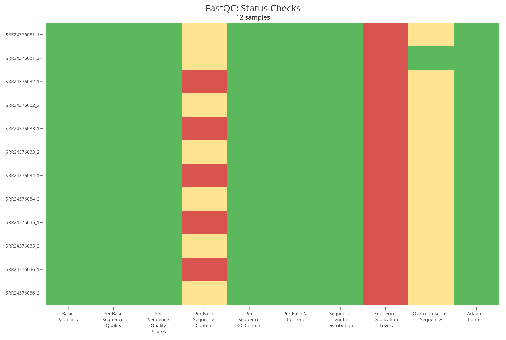
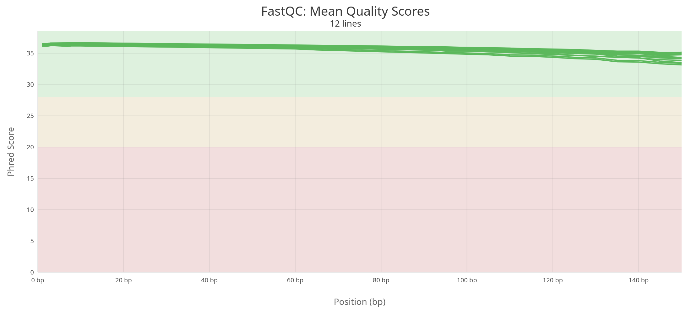
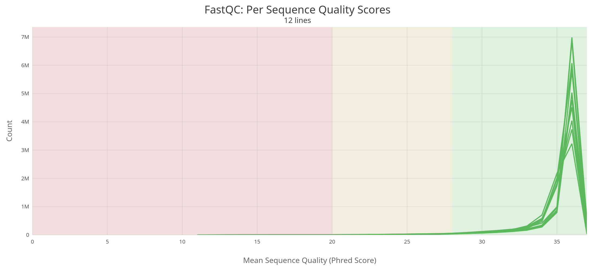
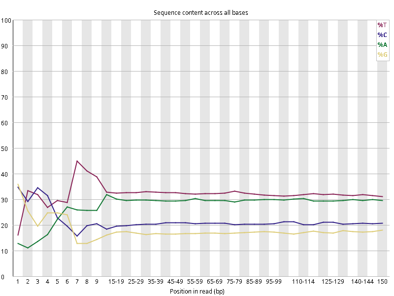
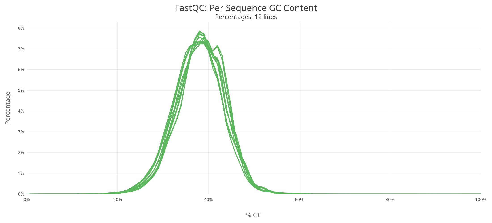
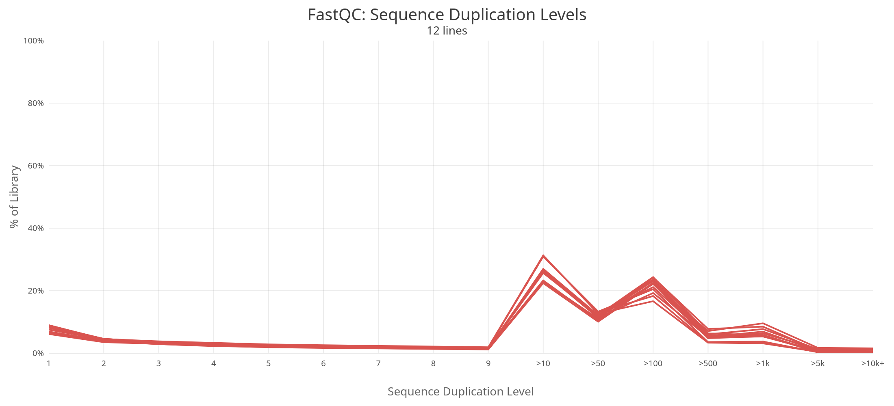
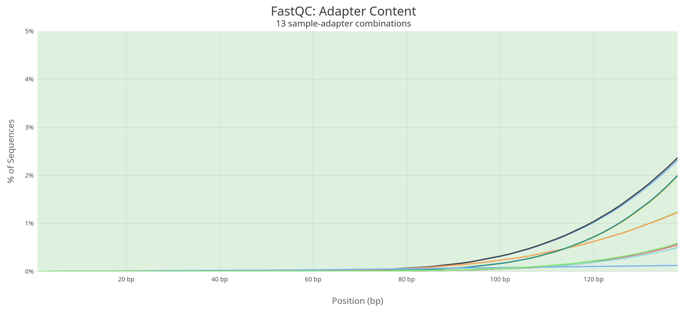

# Week 01 Homework Report: Raw Read Quality Control (Group 04)

**Course:** BT338IU – Practice in Bioinformatics (International University – VNUHCM)  
**Instructor:** Dr. Tran Minh Nhựt  
**Group:** Group 04  
**Dataset:** NCBI BioProject `PRJNA964723` (`SRP435372`)  
**Organism & Reference Genome:** *Lactobacillus johnsonii* N6.2 (`GCF_000498675.1` / `NC_022909.1`)

## 1. Understanding the Dataset and Associated Study

The Group 04 RNA-seq dataset comes from Beliakoff, Gonzalez, and Lorca (2024), *"Bile promotes Lactobacillus johnsonii N6.2 extracellular vesicle production with conserved immunomodulatory properties"* (*Scientific Reports*, 14:12272; DOI: `10.1038/s41598-024-62843-0`; PMID: `38806562`). *Lactobacillus johnsonii* N6.2 is a probiotic bacterium whose extracellular vesicles (EVs) reduce apoptosis in human pancreatic beta cells and elicit tolerogenic immune signaling in THP-1 macrophages. To test whether gastrointestinal bile triggers vesicle release, the authors cultured *L. johnsonii* N6.2 statically at 37 °C in vesicle-depleted MRS (vdMRS) broth either without bile (control) or with 0.2% bovine bile (subinhibitory stress mimicking the small intestine) until mid-exponential phase.

Exposure to 0.2% bovine bile increased EV production roughly 100-fold relative to untreated controls, and EVs isolated from bile-grown cells retained their immunomodulatory activity in human $\beta$lox5 pancreatic and THP-1 macrophage cell lines. For transcriptomic profiling, total RNA was extracted in biological triplicates per condition (`n = 3` control, `n = 3` bile-treated) via bead beating in TRIzol and RiboPure-Bacteria spin columns, treated with TURBO DNase to remove genomic DNA, and sequenced by Novogene on an Illumina NovaSeq 6000 as 150-bp paired-end libraries. Across the six samples, 967 transcripts changed significantly (`padj < 0.05`), with 269 genes upregulated ($\log_2\text{FC} > 1$) and 161 downregulated ($\log_2\text{FC} < -1$). Roughly two-thirds (184 of 269) of the induced genes clustered inside a 300-kb chromosomal region, while bile upregulated peptidoglycan hydrolases (`murV`, `sdp`, `pepD`) and exogenous fatty acid utilization genes (`fakT`, `fakB4`, `fakB1`) and repressed the bile salt importers `cbsT1` and `cbsT2` and the bile salt hydrolase gene `bsh`.

| Group | Replicate | Run Accession | BioSample | Sample Alias | Read Pairs | Total Bases |
| :--- | :---: | :--- | :--- | :--- | ---: | ---: |
| Control (vdMRS) | 1 | `SRR24376036` | `SAMN34488717` | `Ljn_CNTRL_01` | 7,859,010 | 2.36 Gbp |
| Control (vdMRS) | 2 | `SRR24376035` | `SAMN34488718` | `Ljn_CNTRL_02` | 6,995,853 | 2.10 Gbp |
| Control (vdMRS) | 3 | `SRR24376033` | `SAMN34488719` | `Ljn_CNTRL_03` | 9,385,497 | 2.82 Gbp |
| 0.2% Bovine Bile | 1 | `SRR24376032` | `SAMN34488720` | `Ljn_BILE_01` | 7,157,456 | 2.15 Gbp |
| 0.2% Bovine Bile | 2 | `SRR24376034` | `SAMN34488721` | `Ljn_BILE_02` | 7,312,110 | 2.19 Gbp |
| 0.2% Bovine Bile | 3 | `SRR24376031` | `SAMN34488722` | `Ljn_BILE_03` | 9,266,307 | 2.78 Gbp |

In total, the six paired-end runs contain 47,976,233 read pairs (95,952,466 individual reads; 14.39 Gbp). Sequencing depth is balanced between the two experimental groups, with 24.24 million pairs (7.27 Gbp) in Control and 23.74 million pairs (7.12 Gbp) in 0.2% Bile.

## 2. Quality Control Workflow and Summary Results

Raw SRA archives for all six accessions in `group-04_srr-list.txt` were retrieved with `srapath` and `aria2c`, converted to paired-end FASTQ files (`_1.fastq` and `_2.fastq`) with `fasterq-dump`, and evaluated with `FastQC` v0.13.0 (`qc_group-04_sra.sh`). Aggregate diagnostics across all 12 FASTQ files were compiled with `MultiQC` v1.35.

Every FASTQ file passed seven of the ten core FastQC checks (`Basic Statistics`, `Per base sequence quality`, `Per sequence quality scores`, `Per sequence GC content`, `Per base N content`, `Sequence Length Distribution`, and `Adapter Content`). Warnings or failures appeared solely in `Per base sequence content` (5 `FAIL`, 7 `WARN`), `Sequence Duplication Levels` (12 `FAIL`), and `Overrepresented sequences` (11 `WARN`, 1 `PASS`).

| File | Condition | Reads | %GC | Mean Q1 / Q150 | $\ge$ Q30 | Max N | Unique % (Dedup) | Max Adapter | PBSC | SDL | OS |
| :--- | :--- | ---: | :---: | :---: | :---: | :---: | :---: | :---: | :---: | :---: | :---: |
| `SRR24376036_1` | Control R1 | 7,859,010 | 37% | 36.53 / 35.17 | 98.47% | 0.079% | 14.67% | 0.58% | FAIL | FAIL | WARN |
| `SRR24376036_2` | Control R2 | 7,859,010 | 37% | 36.34 / 33.49 | 97.71% | 0.034% | 15.67% | 0.58% | WARN | FAIL | WARN |
| `SRR24376035_1` | Control R1 | 6,995,853 | 37% | 36.46 / 34.86 | 97.81% | 0.073% | 15.81% | 0.50% | FAIL | FAIL | WARN |
| `SRR24376035_2` | Control R2 | 6,995,853 | 37% | 36.31 / 33.38 | 96.07% | 0.037% | 16.69% | 0.49% | WARN | FAIL | WARN |
| `SRR24376033_1` | Control R1 | 9,385,497 | 37% | 36.53 / 35.11 | 98.28% | 0.074% | 14.32% | 0.55% | FAIL | FAIL | WARN |
| `SRR24376033_2` | Control R2 | 9,385,497 | 37% | 36.44 / 34.28 | 97.78% | 0.026% | 13.81% | 0.55% | WARN | FAIL | WARN |
| `SRR24376032_1` | Bile R1 | 7,157,456 | 38% | 36.39 / 34.75 | 97.98% | 0.076% | 14.36% | 1.24% | FAIL | FAIL | WARN |
| `SRR24376032_2` | Bile R2 | 7,157,456 | 37% | 36.12 / 33.15 | 95.89% | 0.037% | 16.02% | 1.23% | WARN | FAIL | WARN |
| `SRR24376034_1` | Bile R1 | 7,312,110 | 38% | 36.15 / 34.32 | 97.13% | 0.116% | 15.76% | 1.98% | FAIL | FAIL | WARN |
| `SRR24376034_2` | Bile R2 | 7,312,110 | 37% | 36.33 / 33.85 | 97.85% | 0.001% | 13.72% | 2.00% | WARN | FAIL | WARN |
| `SRR24376031_1` | Bile R1 | 9,266,307 | 37% | 36.46 / 34.91 | 98.16% | 0.050% | 13.07% | 2.32% | WARN | FAIL | WARN |
| `SRR24376031_2` | Bile R2 | 9,266,307 | 36% | 36.43 / 34.14 | 97.43% | 0.027% | 12.55% | 2.37% | WARN | FAIL | PASS |

Abbreviations in the status columns: `PBSC` = Per base sequence content; `SDL` = Sequence Duplication Levels; `OS` = Overrepresented sequences.

## 3. Interpretation of Key QC Parameters

### Basic Statistics, Read Length, and Ambiguous Bases (`N`)

All 12 files use standard `Sanger / Illumina 1.9` (Phred+33) quality encoding, and 100% of reads across every sample are exactly 150 bp long. `Sequence Length Distribution` therefore passes without variation. Ambiguous base calling is negligible: maximum per-base `N` content ranges from 0.0014% (`SRR24376034_2`) to 0.1160% (`SRR24376034_1`), well below FastQC's 5% warning cutoff, which indicates clean cluster imaging and reliable base calling during sequencing.

### Per Base Sequence Quality and Per Sequence Quality Scores

Phred quality scores measure base-call error probability on a logarithmic scale, $Q = -10 \log_{10}(P_{\text{error}})$, where `Q30` corresponds to 99.9% base accuracy (1 error in 1,000 bases) and `Q20` corresponds to 99% accuracy. FastQC issues a `WARN` if the lower quartile at any position drops below 10 or the median drops below 25, and a `FAIL` if the lower quartile drops below 5 or the median drops below 20.

Across all 12 FASTQ files, mean Phred quality starts between `Q36.12` and `Q36.53` at cycle 1 and ends between `Q33.15` and `Q35.17` at cycle 150, staying inside the green high-quality zone across the full read length. Reverse reads (`_2`) show the expected minor 3'-end decay relative to forward reads (`_1`), dropping about 1.2–1.5 Phred points more by cycle 150. On the Illumina NovaSeq 6000, quality scores are binned into four discrete tiers (`Q12/15`, `Q25`, `Q36/37`), so the 10th percentile steps down from `Q37` to `Q25` near positions 125–150 while the median remains `Q37` throughout. At the read level, `Per sequence quality scores` peaks sharply at `Q36` in every library, with 95.89% to 98.47% of reads achieving a mean quality of `Q30` or higher.

### Per Base Sequence Content

This module checks whether the proportions of A, T, G, and C stay uniform along the read; FastQC triggers a `WARN` if the difference between A and T or between G and C exceeds 10% at any position, and a `FAIL` if it exceeds 20%. Five forward-read files (`SRR24376032_1` to `SRR24376036_1`) failed this check, and the remaining seven files received a warning.

Every file displays the same localized pattern: strong nucleotide oscillation across bases 1–9 (for example, ~35–36% G and ~33–35% C at position 1 in forward reads, spiking to ~40–45% T at positions 7–8, and up to ~42% A at position 6 in reverse reads), followed by flat base composition from position 15 to 150 (~30–33% A, ~30–33% T, ~16–21% G, ~16–21% C). This 5' bias is a normal artifact of random hexamer priming during cDNA synthesis in Illumina RNA-seq libraries because hexamers anneal with sequence preference at fragment ends. It does not indicate poor base calling and does not affect splice-aware or bacterial transcriptome alignment once the remaining ~135–140 bases match the target locus.

### Per Sequence GC Content

FastQC compares the GC distribution of reads against a theoretical normal curve built from the observed library mean; non-normal peaks or extra shoulders usually point to adapter contamination, unremoved rRNA spikes, or foreign organism DNA.

All 12 libraries form a clean, single unimodal peak centered at 37%–38% GC (mode `38%` across every file), with zero secondary peaks at high or low GC. The *L. johnsonii* N6.2 reference chromosome (`GCF_000498675.1`, 1,887,251 bp) has an overall genomic GC content of 34.5%, and transcribed coding regions in AT-rich Firmicutes are typically 2–3 percentage points higher in GC than intergenic AT-rich tracts. The single tight peak around 37%–38% confirms that the sequenced RNA derives cleanly from *L. johnsonii* N6.2 without foreign microbial or host contamination.

### Sequence Duplication Levels and Overrepresented Sequences

FastQC's `Sequence Duplication Levels` module flags libraries when non-unique sequences exceed 20% (`WARN`) or 50% (`FAIL`) of the first 100,000 reads, and `Overrepresented sequences` flags individual 50-bp prefixes making up more than 0.1% (`WARN`) or 1% (`FAIL`) of a file. All 12 files failed `Sequence Duplication Levels` (only 12.55%–16.69% unique sequences remaining after deduplication, with 22.4%–31.3% of reads in the `>10` duplication bin and 16.6%–24.3% in `>100`), and 11 of 12 files received a `WARN` for `Overrepresented sequences` (3–10 sequences per file, maximum single sequence abundance 0.58% in `SRR24376032_1`).

In a compact 1.89-Mb bacterial genome containing 1,674 protein-coding genes, sequencing 7.0–9.4 million 150-bp paired-end reads per replicate provides over 1,100× theoretical depth relative to total chromosome length. Highly expressed operons naturally generate hundreds to thousands of reads sharing identical fragmentation coordinates, so FastQC's default thresholds (designed for whole-genome shotgun DNA libraries) routinely fail in deep bacterial RNA-seq.

To verify whether the overrepresented 50-bp sequences came from contaminants or genuine *L. johnsonii* N6.2 transcripts, we mapped all 24 unique overrepresented sequences reported across the 12 files against the `NC_022909.1` reference sequence and feature table. FastQC marked them `No Hit` only because its built-in list searches adapters and vectors; 23 of the 24 prefixes match endogenous *L. johnsonii* N6.2 loci with 100% identity, and the remaining sequence (`GTGGAGATGAGGGGAATTGAACCCC...`, 0.13% in `SRR24376031_1`) overlaps the 3' end of tmRNA. The dominant overrepresented hits are small abundant non-coding RNAs that escape standard 16S/23S/5S rRNA depletion, led by RNase P RNA component class B (`rnpB`, coordinates 983,074–983,384; up to 0.58% of reads) and transfer-messenger RNA (`ssrA`/tmRNA, coordinates 1,281,025–1,281,302; up to 0.29%), alongside abundant housekeeping mRNAs for type I glyceraldehyde-3-phosphate dehydrogenase (`gapdh`, 1,317,972–1,318,968; up to 0.14%), elongation factor Tu (`tuf`, 1,182,409; 0.11%), and a P8 family protein locus (416,189–416,390; up to 0.16%). No Illumina adapter dimers or vector sequences appear among the overrepresented reads.

### Adapter Content

FastQC scans each read position for known sequencing adapters and triggers a `WARN` at 5% or a `FAIL` at 10%.

Every file passed `Adapter Content`, with detectable Illumina Universal Adapter read-through staying near zero until cycle 80 and remaining well under 5% at cycle 150. Adapter levels separate cleanly by treatment group: Control replicates peak at 0.49%–0.58% (`SRR24376033`, `SRR24376035`, `SRR24376036`), whereas 0.2% Bile replicates reach 1.23%–2.37% (`SRR24376032`: 1.23%–1.24%; `SRR24376034`: 1.98%–2.00%; `SRR24376031`: 2.32%–2.37%). Bile-treated libraries therefore contain a slightly higher fraction of short cDNA inserts (<150 bp) where sequencing reads through into the 3' adapter.

## 4. Downstream Readiness and Preprocessing Recommendations

The Group 04 dataset is clean, balanced in sequencing depth across all six replicates, and ready for downstream RNA-seq analysis against *L. johnsonii* N6.2 (`GCF_000498675.1`). Before alignment with `Bowtie2` or `HISAT2`, light read trimming with `fastp` or `Trimmomatic` should be applied to clip residual 3' Illumina Universal Adapters (especially the 1.2%–2.4% read-through tail in the bile-treated libraries) and trim low-quality 3' bases (`SLIDINGWINDOW:4:20` or Phred $\ge 20$, minimum retained length 50 bp). Hard-clipping the first 9–10 bases for the 5' hexamer priming bias is optional and generally unnecessary for bacterial genome alignment, and reads should **not** be deduplicated prior to `featureCounts` or `htseq-count` quantification because high sequence duplication reflects genuine transcript abundance in a 1.89-Mb genome.

## References

1. Beliakoff, R. E., Gonzalez, C. F., & Lorca, G. L. (2024). Bile promotes *Lactobacillus johnsonii* N6.2 extracellular vesicle production with conserved immunomodulatory properties. *Scientific Reports*, 14(1), 12272. https://doi.org/10.1038/s41598-024-62843-0
2. NCBI BioProject `PRJNA964723` / SRA Study `SRP435372` (`SRR24376031`–`SRR24376036`), University of Florida.
3. NCBI RefSeq Assembly `GCF_000498675.1` (`NC_022909.1`), *Lactobacillus johnsonii* N6.2 (`ASM49867v1`).
4. Andrews, S. (2010). *FastQC: A Quality Control Tool for High Throughput Sequence Data* (v0.13.0 used here); Ewels, P., et al. (2016). *MultiQC*, *Bioinformatics*, 32(19), 3047–3048.
