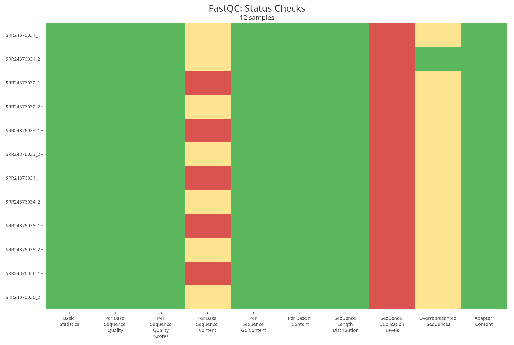
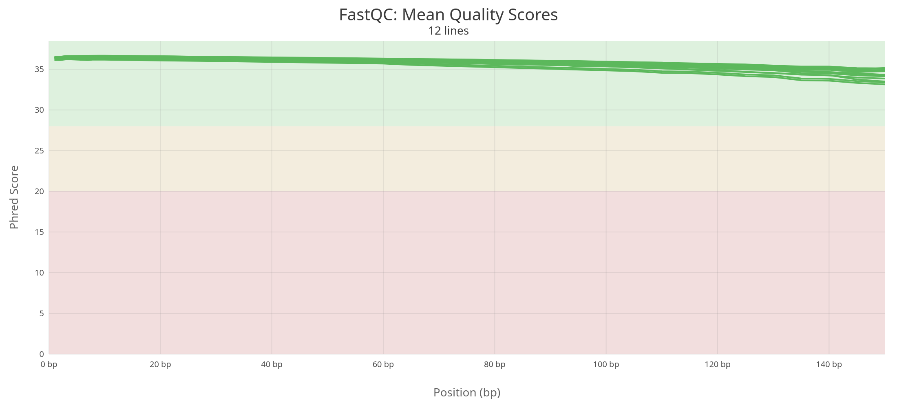
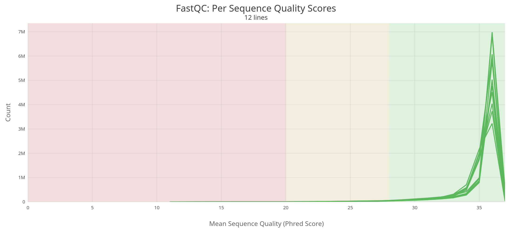
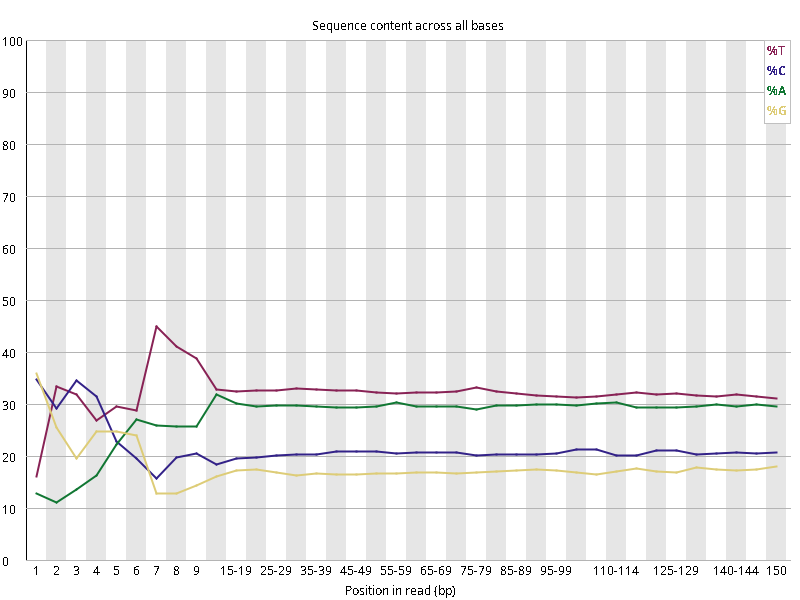
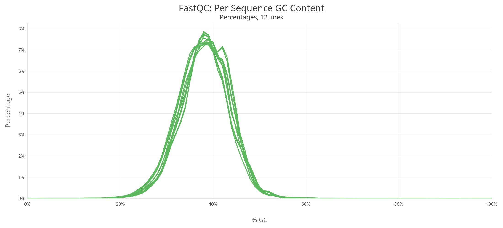
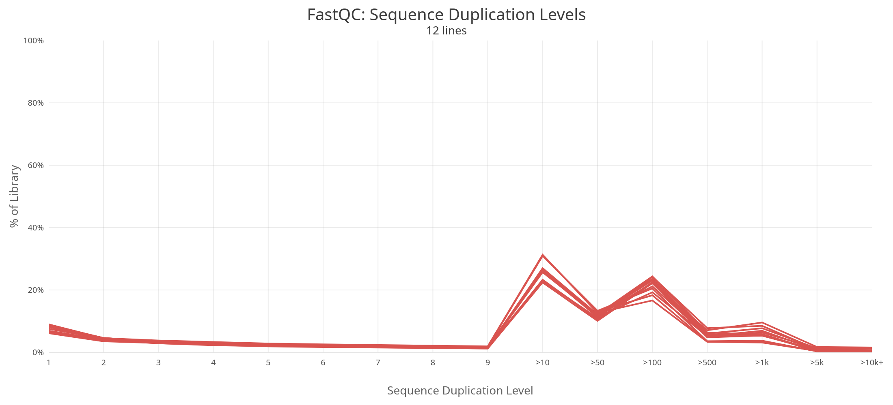
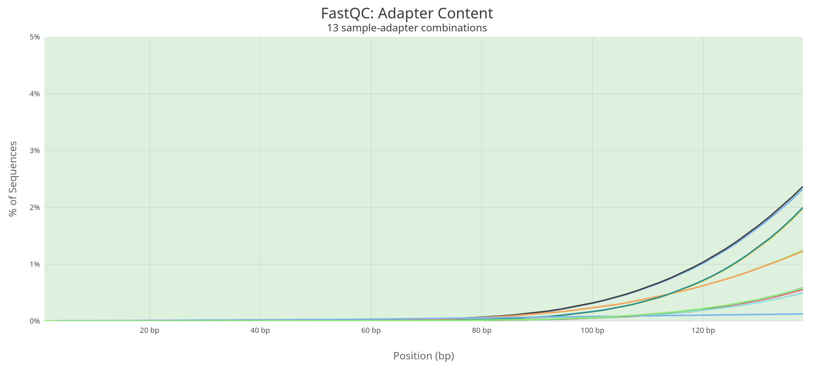

# Homework 01: Raw Read Quality Control (Group 04)

**Course:** BT338IU – Practice in Bioinformatics  
**Instructor:** Dr. Tran Minh Nhựt  
**Group:** 04 | **BioProject:** `PRJNA964723`  
**Organism:** *Lactobacillus johnsonii* N6.2 (`GCF_000498675.1`)

## 1. Study Background and Dataset

Our assigned dataset comes from Beliakoff et al. [1]. In this study, the probiotic bacterium *L. johnsonii* N6.2 was grown in control broth (vdMRS) or with 0.2% bovine bile to mimic stress in the small intestine. Bile caused the bacteria to release ~100-fold more extracellular vesicles (EVs), and those EVs kept their immune-regulating activity in human pancreatic (βlox5) and macrophage (THP-1) cells.

To see which genes responded to bile, the authors extracted total RNA from three biological replicates per condition (`n = 3` control, `n = 3` bile) for paired-end Illumina sequencing (150-bp reads on an Illumina NovaSeq 6000, per `PRJNA964723` SRA metadata [2]). Bile changed the expression of 967 transcripts (`padj < 0.05`), upregulating cell-wall remodeling enzymes (`murV`, `sdp`, `pepD`) and fatty acid utilization/uptake genes (`fakT`, `fakB4`, `fakB1`) while downregulating bile salt transporters (`cbsT1`, `cbsT2`) and bile salt hydrolase (`bsh`).

| Condition | Replicate | Run ID | Sample Alias | Read Pairs |
| :--- | :---: | :--- | :--- | ---: |
| Control (vdMRS) | 1 | `SRR24376036` | `Ljn_CNTRL_01` | 7,859,010 |
| Control (vdMRS) | 2 | `SRR24376035` | `Ljn_CNTRL_02` | 6,995,853 |
| Control (vdMRS) | 3 | `SRR24376033` | `Ljn_CNTRL_03` | 9,385,497 |
| 0.2% Bovine Bile | 1 | `SRR24376032` | `Ljn_BILE_01` | 7,157,456 |
| 0.2% Bovine Bile | 2 | `SRR24376034` | `Ljn_BILE_02` | 7,312,110 |
| 0.2% Bovine Bile | 3 | `SRR24376031` | `Ljn_BILE_03` | 9,266,307 |

## 2. FastQC Overview

We ran `FastQC` (v0.13.0) [3] on all 12 FASTQ files (forward `_1` and reverse `_2` reads for each run) and combined the plots using `MultiQC` (v1.35) [4]. Eleven of the 12 files passed 7 out of 10 FastQC checks, while `SRR24376031_2` passed 8 out of 10 (passing `Overrepresented sequences`). Warnings or failures appeared only in `Per base sequence content` (PBSC), `Sequence Duplication Levels` (SDL), and `Overrepresented sequences` (OS).

| File | Group | Total Sequences | Length | %GC | PBSC | SDL | OS |
| :--- | :--- | ---: | :---: | :---: | :---: | :---: | :---: |
| `SRR24376036_1` | Control R1 | 7,859,010 | 150 bp | 37% | FAIL | FAIL | WARN |
| `SRR24376036_2` | Control R2 | 7,859,010 | 150 bp | 37% | WARN | FAIL | WARN |
| `SRR24376035_1` | Control R1 | 6,995,853 | 150 bp | 37% | FAIL | FAIL | WARN |
| `SRR24376035_2` | Control R2 | 6,995,853 | 150 bp | 37% | WARN | FAIL | WARN |
| `SRR24376033_1` | Control R1 | 9,385,497 | 150 bp | 37% | FAIL | FAIL | WARN |
| `SRR24376033_2` | Control R2 | 9,385,497 | 150 bp | 37% | WARN | FAIL | WARN |
| `SRR24376032_1` | Bile R1 | 7,157,456 | 150 bp | 38% | FAIL | FAIL | WARN |
| `SRR24376032_2` | Bile R2 | 7,157,456 | 150 bp | 37% | WARN | FAIL | WARN |
| `SRR24376034_1` | Bile R1 | 7,312,110 | 150 bp | 38% | FAIL | FAIL | WARN |
| `SRR24376034_2` | Bile R2 | 7,312,110 | 150 bp | 37% | WARN | FAIL | WARN |
| `SRR24376031_1` | Bile R1 | 9,266,307 | 150 bp | 37% | WARN | FAIL | WARN |
| `SRR24376031_2` | Bile R2 | 9,266,307 | 150 bp | 36% | WARN | FAIL | PASS |

## 3. Understanding the QC Parameters

### Basic Statistics, Read Length, and N Content (`PASS`)

Each sample has between 7.0 and 9.4 million read pairs, and all reads are uniformly 150 bp long. Ambiguous bases (`N`, meaning the sequencer could not call A, T, G, or C) stay near 0% across all positions, so base calling ran cleanly.

### Per Base and Per Sequence Quality (`PASS`)

Quality scores use the Phred scale, where `Q20` means 99% base-call accuracy and `Q30` means 99.9% accuracy. Across all 12 files, mean quality stays inside the green high-quality zone (roughly Q33 to Q37) from base 1 to base 150, with only a small drop near the 3' end of reverse reads (`_2`). In `Per sequence quality scores`, read mean qualities peak sharply at Q36 across every file, with 95.9%–98.5% of reads reaching Q30 or higher, which means the raw reads are accurate enough for alignment.

### Per Base Sequence Content (`WARN` / `FAIL`)

This check expects A, T, G, and C proportions to stay balanced along the read. In our files, the first ~10 bases fluctuate noticeably before leveling off from base 15 to 150 (~30–33% A/T and ~16–21% G/C). This 5' wobble is normal in RNA-seq libraries because the random hexamer primers used during cDNA synthesis bind certain short sequences more easily than others [5]. It does not mean the reads are low quality.

### Per Sequence GC Content (`PASS`)

Every library forms a single smooth peak centered around 37%–38% GC, close to the *L. johnsonii* N6.2 reference genome (~34.5% GC; RefSeq `GCF_000498675.1`) [6]. A single bell-shaped curve without extra bumps means our reads come from the target bacterium without contamination from another organism.

### Sequence Duplication Levels (`FAIL`) and Overrepresented Sequences (`WARN`)

FastQC expects most reads to be unique, which is true for whole-genome DNA sequencing. In bacterial RNA-seq, however, highly active genes make many copies of the same transcript inside a small 1.89-Mb genome [6], so identical reads appear often (only ~13%–17% remain unique after deduplication). Likewise, the flagged overrepresented sequences each make up less than 0.6% of a file and mark `No Hit` in FastQC's adapter list because they are abundant native RNAs left in the sample, not adapter dimers.

### Adapter Content (`PASS`)

Sequencing adapters can appear at the 3' end if a cDNA fragment is shorter than 150 bp. Adapter levels stay near 0% for most of the read and reach at most ~0.6% in Control and ~2.4% in Bile at the 3' tail, well below FastQC's 5% warning cutoff.

## References

1. Beliakoff RE, Gonzalez CF, Lorca GL. Bile promotes *Lactobacillus johnsonii* N6.2 extracellular vesicle production with conserved immunomodulatory properties. Sci Rep. 2024;14(1):12272. doi:10.1038/s41598-024-62843-0
2. Beliakoff RE, Gonzalez CF, Lorca GL. BioProject PRJNA964723: Bile promotes *Lactobacillus johnsonii* N6.2 extracellular vesicle production with conserved immunomodulatory properties (SRA runs `SRR24376031`–`SRR24376036`) [Internet]. Bethesda (MD): National Center for Biotechnology Information; 2024 [cited 2026 Nov 19]. Available from: https://www.ncbi.nlm.nih.gov/bioproject/PRJNA964723
3. Andrews S. FastQC: a quality control tool for high throughput sequence data [Internet]. Version 0.13.0. Cambridge (UK): Babraham Bioinformatics; 2010 [updated 2026 Oct 2; cited 2026 Nov 19]. Available from: https://www.bioinformatics.babraham.ac.uk/projects/fastqc/
4. Ewels P, Magnusson M, Lundin S, Käller M. MultiQC: summarize analysis results for multiple tools and samples in a single report. Bioinformatics. 2016;32(19):3047-3048. doi:10.1093/bioinformatics/btw354
5. Hansen KD, Brenner SE, Dudoit S. Biases in Illumina transcriptome sequencing caused by random hexamer priming. Nucleic Acids Res. 2010;38(12):e131. doi:10.1093/nar/gkq224
6. Leonard MT, Valladares RB, Ardissone A, Gonzalez CF, Lorca GL, Triplett EW. Complete genome sequences of *Lactobacillus johnsonii* strain N6.2 and *Lactobacillus reuteri* strain TD1. Genome Announc. 2014;2(3):e00397-14. doi:10.1128/genomeA.00397-14
