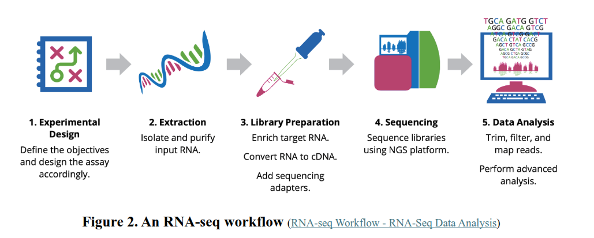
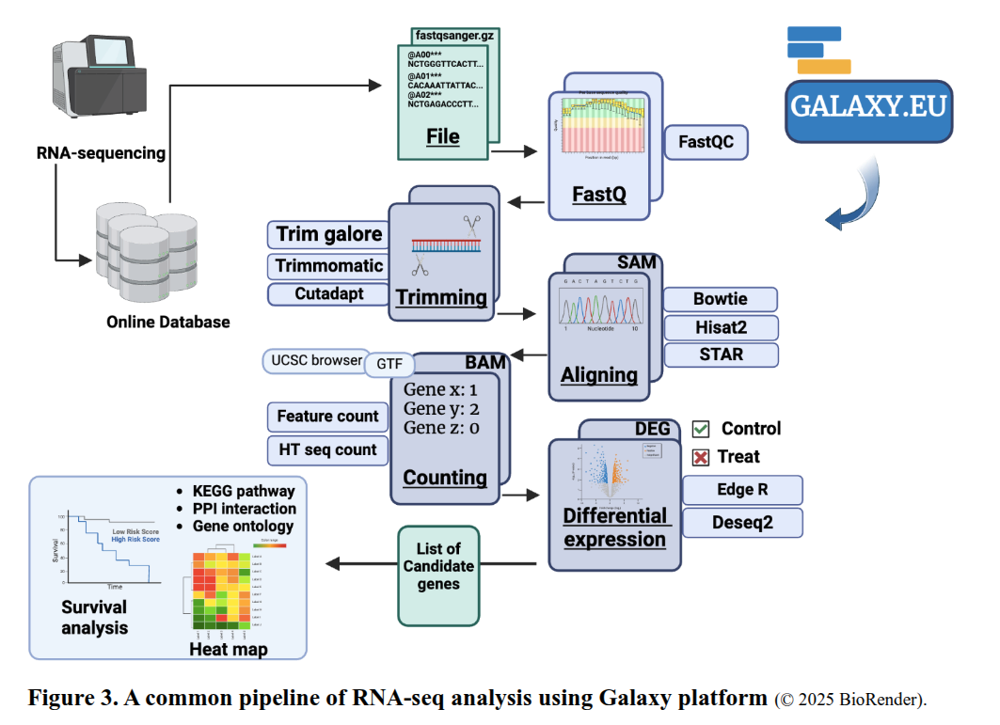

# Prelab 01: Lecture 2 Summary (Galaxy Platform and RNA-Seq Analysis)

**Course:** BT338IU – Practice in Bioinformatics | **Instructor:** Dr. Tran Minh Nhựt

## 1. Objectives and biological background

Lecture 2 covers running a reference-based RNA sequencing (RNA-seq) pipeline on Galaxy (`usegalaxy.eu`) with NCBI datasets and interpreting gene expression results.

When a gene is active, it is transcribed into mRNA to make protein, so mRNA abundance tracks expression level. Most cells in an organism carry the same genome, yet only about one-third of all genes are expressed in a tissue at one time: housekeeping genes stay active everywhere for basic functions, while others are restricted to specific tissues or developmental stages. The full set of transcripts in a sample is its transcriptome. RNA-seq uses next-generation sequencing (NGS) to measure transcript levels and alternative splicing more accurately than older methods (Figure 2).

## 2. Core RNA-seq pipeline on Galaxy

Differential expression (DE) analysis is the main goal of the Galaxy workflow (Figure 3), which starts from raw `fastqsanger.gz` reads. First, `FastQC` checks read quality to guide filtering, and `Trimmomatic` trims leftover adapters and low-quality bases that lower mapping rates.

Cleaned reads are mapped to a reference genome or assembly. Reads from repetitive regions (such as paralogous genes sharing conserved domains) cannot map uniquely, and aligners allow controlled mismatches for sequencing errors and true mutations. Because of this, accuracy depends on how multi-mapped and partial reads are handled. Reference mapping needs `FASTA` sequences, `GTF` annotations (RefSeq, Ensembl, UCSC, or custom), and a genome index. Without a reference genome, reads require genome-guided or *de novo* assembly. In this lab, `HISAT2` aligns the reads and reports the overall alignment rate plus counts of unmapped, uniquely mapped, and multi-mapped reads (and concordant vs. discordant pairs for paired-end data). `SAMtools` converts `.sam` output into compressed, sorted binary `.bam` files. Next, `HTSeq` (`htseq-count`) counts reads per gene, transcript, or exon from the `GTF` file and writes one count file per sample for R.

## 3. Downstream analysis, variant calling, and lab practice

Sample count files are combined into a count table to compare conditions (e.g., control vs. treatment) and find differentially expressed genes (DEGs). In R/RStudio, `DESeq2` fits negative binomial generalized linear models with data-driven priors for dispersion and log2 fold changes; significant DEGs are selected by `log2FoldChange` and adjusted p-value (`padj`).

To interpret DEGs biologically, functional analysis tests enrichment of pathways or interactions (GO, KEGG, PPI networks), groups co-expressed genes into networks, and maps expression changes onto interaction data. The manual uses `Blast2GO` in five steps: BLAST search, GO mapping, annotation (GO evaluation, Enzyme Codes, InterProScan motifs), statistical summaries, and visualization across Biological Process, Molecular Function, and Cellular Component.

Sorted `.bam` files also support transcriptome variant calling: `SAMtools` and `BCFtools` write SNPs and small indels to `.vcf` files for inspection in Integrative Genomics Viewer (`IGV`). In the Lecture 2 group project, students follow the Galaxy Training Network reference-based RNA-seq tutorial to analyze differential expression in an assigned species using NCBI data.
